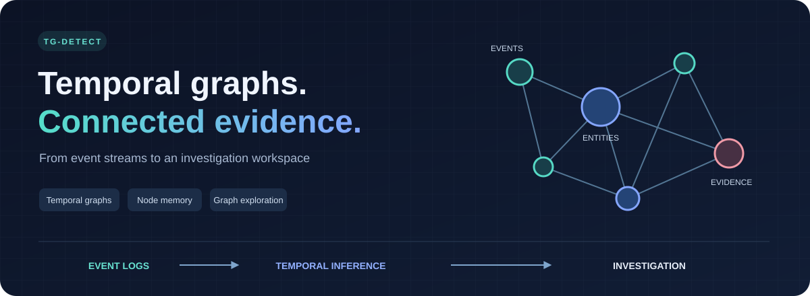
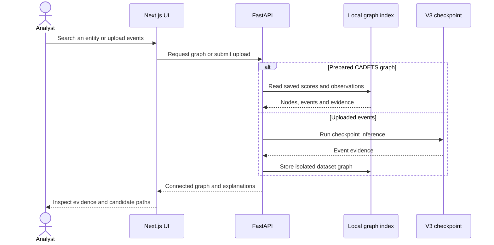

<p align="center">
  
</p>

<p align="center">
  <a href="LICENSE"></a>
  
  
  
</p>

<p align="center">
  <a href="#what-you-can-do">Features</a> ·
  <a href="#how-it-works">Architecture</a> ·
  <a href="#run-locally">Run locally</a> ·
  <a href="#research-and-verification">Research</a> ·
  <a href="#license">License</a>
</p>

# TG-Detect

TG-Detect combines temporal graph research with a local security investigation
workspace. The CADETS V3 pipeline scores endpoint events and entities; the web
application lets analysts explore connected observations, inspect evidence and
trace chronological candidate paths.

**This repository publishes source code.** Datasets, reference papers, trained
weights, experiment artifacts and archived project copies stay local. Supply the
prepared data and checkpoint before using inference or data-backed API features.

## What you can do

| Workspace | What it provides |
| --- | --- |
| Detection graph | Search entities, focus connected neighborhoods, filter predictions and export graphs. |
| Investigation | Inspect scored nodes, contributing events and chronological candidate paths. |
| Event explorer | Browse dataset splits and inspect endpoint attributes and relations. |
| Model validation | Replay the CADETS checkpoint against recorded scores. |
| Dataset uploads | Import supported JSON, JSONL or CSV events and explore an isolated scored graph. |
| Research | Compare model versions, investigate encoders and graph attention, and reproduce documented experiments. |

Predictions require analyst review. Connected paths describe investigative
hypotheses; anomaly evidence is not a probability of compromise. Recorded
experiment findings retain their original scope and limitations.

## How it works

```mermaid
flowchart LR
    A[Endpoint event logs] --> B[Typed event encoding]
    B --> C[Causal graph context]
    C --> D[Temporal processing and node memory]
    D --> E[Event evidence and entity scores]
    E --> F[FastAPI investigation APIs]
    F --> G[Next.js workspace]
    G --> H[Search · inspect · trace · export]

    classDef input fill:#e0f7f2,stroke:#148b78,color:#102b27
    classDef model fill:#e7edff,stroke:#5c73c5,color:#172440
    classDef app fill:#fff0f2,stroke:#b66b7b,color:#3c2029
    class A,B input
    class C,D,E model
    class F,G,H app
```



The backend reads the prepared corpus, checkpoint and investigation index from
`datasets/application/cadets_v3/`. Model definitions live in `web_app/model/`;
experiment implementations live in `research/`. The browser uses the frontend's
`/api` proxy to communicate with FastAPI.



## Repository layout

```text
TG-Detect/
├── web_app/
│   ├── frontend/          Next.js application and shared UI
│   ├── backend/           FastAPI APIs and preparation commands
│   └── model/             Inference definitions and preprocessing
├── research/              Experiments, audits, comparisons and regression tests
│   ├── support/           Regression fixture helper
│   ├── artifacts/         Local experiment outputs                  [ignored]
│   └── archives/          Preserved historical project versions     [ignored]
├── datasets/              Raw/prepared data, weights and uploads    [ignored]
├── research paper/        PDFs, manuscript and presentation assets  [ignored]
├── docs/assets/           README illustrations
├── pytest.ini             Active test discovery configuration
├── LICENSE                MIT license for original TGDetect work
└── NOTICE.md              Component attribution and license scope
```

Trained model formats such as `.pt`, `.pth`, `.ckpt`, `.safetensors` and `.onnx`
are ignored throughout the repository. The GAT notebook with an embedded corpus
and encoder weights stays local; its Python source and notebook builder remain
available. Ignore rules do not remove assets from earlier Git history.

## Run locally

Use Python 3.10+ and a Node.js version compatible with the installed Next.js
release. The existing project environment is supported; a fresh environment can
be created as follows:

```bash
git clone https://github.com/MaheshMarathe005/TGDetect.git
cd TGDetect
python3 -m venv .venv
source .venv/bin/activate
python -m pip install -r web_app/backend/requirements.txt
```

Install an appropriate PyTorch CPU/CUDA build for your machine when needed.
The local web application does not require a GPU. Research/cloud scripts may
require additional packages and a configured Modal account.

### 1. Supply local application assets

Place the prepared CADETS corpus, token bank, trained checkpoint, saved result
and investigation index under `datasets/application/cadets_v3/`. Consult the
[CADETS guide](web_app/backend/CADETS.md) for preparation commands and schema.
These files are intentionally excluded from this source push.

### 2. Start the backend

From the repository root:

```bash
python -m uvicorn web_app.backend.backend:app --host 127.0.0.1 --port 8000
```

### 3. Start the frontend

In another terminal:

```bash
cd web_app/frontend
npm ci
npm run build
npm run start
```

Open **http://localhost:3000**. FastAPI's interactive API documentation is at
**http://127.0.0.1:8000/docs**. For development, use `npm run dev` and add `--reload`
to the backend command. Set `TGDETECT_API_ORIGIN` when the backend uses a different
address; rebuild/restart the frontend after changing it.

## Research and verification

[Codebase notes](research/CODEBASE_NOTES.md) explain the script families and
application dependencies. The [script inventory](research/SCRIPT_INVENTORY.md)
and [relocation manifest](research/RESTRUCTURE_MANIFEST.json) document the source
scan, path changes and removal of 14 temporary checks. Regression tests remain.

Run model tests without application assets:

```bash
python -m pip install pytest
python -m pytest -q research/test_sliding_v3.py research/test_node_memory_v3.py
```

For CADETS API/inference checks after supplying local assets:

```bash
python -m pip install pytest httpx
python -m pytest -q research/test_cadets_dashboard.py research/test_graph_uploads.py
```

Run experiment commands from `research/`. For scripts using the older `data/`
default, create a local link after providing raw datasets:

```bash
cd research
ln -s ../datasets/raw data
```

| Latest local verification | Result |
| --- | --- |
| CADETS/API/upload/model/foundation selection | 47 passed; 4 documented expected failures |
| Encoder/GAT/slice/upgrade selection | 73 passed; overlaps the first selection on V3 tests |
| Active test collection | 261 tests collected without errors |
| Frontend production build | Passed, including TypeScript and static routes |
| Existing frontend lint | 13 errors in unchanged frontend source |
| Optional legacy Sysmon tests | 10 failures because separate DEDALE result artifacts are absent |

The optional `/legacy` UI uses independent Sysmon/DEDALE artifacts. Its missing
results do not affect the prepared CADETS pipeline; its regression tests remain
available. Archived project copies and generated source snapshots are excluded
from active test collection.

## License

Original TGDetect code and documentation are released under the [MIT License](LICENSE).
Existing third-party notices remain applicable; see [NOTICE.md](NOTICE.md) and the
[frontend's original license](web_app/frontend/LICENSE). Source licensing does not
cover dataset contents, trained weights or published research papers.
