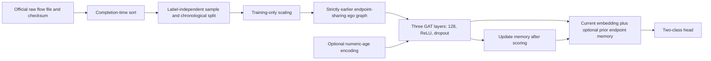
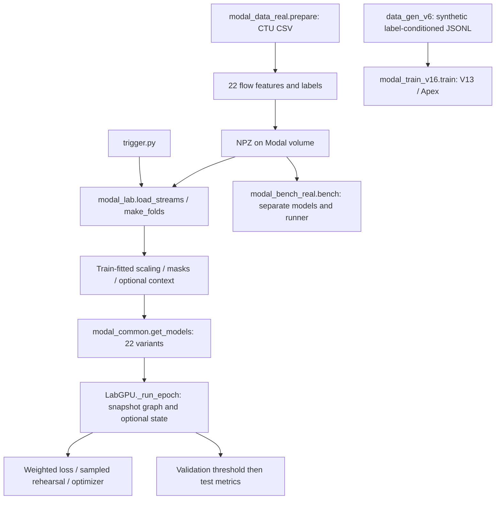

# Source architecture and baseline audit

## New canonical path, second session

Legacy findings below remain valid for their original source paths. The new
`PomsathitAdapted` / `CausalTGNN` paths have their own protocol and acceptance tests.

| Function / module | Input → output | Information and learning | Isolation / cost |
|---|---|---|---|
| fetch_pilot_data.fetch | scenario → raw text + source manifest | Direct HTTPS retrieval and local hash; no model | Read-only reuse must match source and hash |
| causal_data.transport_port | protocol/token → normalized-source port or missing | Static TCP/UDP only; excludes other protocol fields | Explicit non-port regression test |
| causal_data.prepare | raw rows → sorted sample, feature arrays, split manifest | Labels used only for targets/support checks; IDs only index graph/state; completion proxy | Thinning and capture selection disclosed; no absolute time or IDs fed as features |
| fit_scaler | training N×10 → mean/std | Training-only statistics | Perturbing evaluation features cannot alter fit |
| causal_egos | endpoint/time stream → N×5 indices/mask/log-age | Last 4 strictly earlier incident events; no labels | Prefix invariant; equal-time peers excluded; O(N×4) output |
| CausalGATLayer | B×5×D → B×5×128 | Learned single-head masked attention; ReLU/.2 | Hand-computed uniform-attention test; padded nodes cannot send to target |
| PomsathitAdapted.encode | ego feature/mask → B×128 | Three graph layers; current target only | Graphs independent per event; no cross-minibatch edges |
| CausalTGNN.time_encoder | B×5×1 → B×5×128 | Optional learned cosine/log-age; 256 parameters | Absent when T disabled; constant/shuffled-age interventions |
| CausalTGNN.forward_events | ego + endpoints/time → B×2 logits, B×128 context | Reads prior memory, scores, queues current embedding; no labels accepted | Future perturbation and eval-batch invariance; self/new-node tests |
| _commit | queued prior-time embeddings → endpoint memory | Fixed averaging M or learned GRU R; equal-time updates delayed until later time | R requires M; all four GRU tensors receive detection gradients |
| reset_state / detach_state | state → zero / truncated graph | Reset each epoch/eval start; detach between optimizer steps | Evaluation replay repeatable; 256-event gradient truncation |
| replay | stored causal ego + detached context → B×2 logits | Recomputes current-weight graph; stale context; no live-state writes | Snapshot approximation explicit; cannot change stream state |
| Reservoir | training visits → bounded uniform subset | Dedicated seeded Algorithm R; no label-biased admission | Evaluation IDs rejected; statistical inclusion-frequency test |
| train_one | training chronology → checkpoint/log | Unweighted CE, Adam; current block plus optional replay | Same live visits across arms; replay cost recorded separately |
| predict | fresh state + chronology → probabilities | Frozen weights; label-free stream updates through train, validation, test | No training-state reuse; interventions restart from zero |
| select_threshold / metrics | validation scores → threshold; test → metrics | Max validation F1, highest threshold on tie | No test threshold optimization; AP explicitly defined |

Memory stores up to 128 float32 values per observed endpoint plus pending embeddings
and Python-container overhead. Reports count tensor bytes separately from process
peak RSS. GRU update has 99072 parameters; total model profiles are persisted with
the pilot. Recency already enters the common graph, so this tests additional time
and persistent state. It is not a static-topology vs temporal-topology experiment.

The new suite passes. Four legacy XFAILs remain in the old code, intentionally
separate from the new tested path. Full F/G/L/N replacements and multi-scenario
robustness remain unimplemented; they are not hidden in a purported full TGNN.

Date: 2026-09-23. This document records independently inspected code, not prior source-comment claims. `EXISTING_MODEL_AUDIT.json` contains source hashes, all discovered function/class locations, 22 registry variants, and measured parameter and tensor profiles. An indexed symbol is **not** a completed scientific audit of that function.

## Entry points and data flow

Legacy diagnostics now use `modal_lab.py` through `trigger.py diag`; the superseded `modal_diag.py` was removed during cleanup. `.labtest/harness.py` generates synthetic data and patches paths for local diagnostics. Its preserved local NPZs exactly match seed-0 generated arrays; they are not a real CTU-13 release. Future fixtures use a temporary directory and real installed scikit-learn. The unused `sk_stub.py` was also removed. Original hashes and removal reasons are recorded in `CLEANUP_MANIFEST.json`.

## All purported literature baseline paths

| Component | Paper | `modal_common.get_models()['Pomsathit_GCN']` | `modal_bench_real.bench` local `PomsathitGCN` | `modal_train_v16.train` label `V13_GNN_Rehearsal` | Exact / consequence |
|---|---|---|---|---|---|
| Actual class | Unique operator unspecified | Local `PomsathitGCN` | Separate local `PomsathitGCN` | `BaseModel(is_apex=False)`, not a class called V13 | Three different paths |
| Layers / hidden | 3 / 128 | 3 / 128 | 3 / 128 | 2 / 64 | V13 mismatches both |
| Features | Node command lines/hashes/IPs; encoder unknown | 22 flow features → 128 → 128 | Same | Python-hashed identity embedding 10000×64 | All are adaptations |
| Graph | Node interaction graph, details missing | Batch graph; node init = mean incident encoded flows | Same batch graph | Per-event source/destination pair, no neighbor graph aggregation | Different information paths |
| Messages | Eq.3 generic attention | Linear on neighbor + edge; ReLU; separate incoming/outgoing softmax | Same | 4-head Q/K/V; softmax over heads for V13 | Cannot identify as exact paper GAT |
| Residuals | Not reported | `relu(h + agg)` | Same | Attention and feed-forward residuals | Extra choice |
| Dropout | 0.2, placement unknown | In feature/head MLPs; `self.drop` never called | None | None | Common is closer only in rate |
| Prediction head | Linear node head + softmax | Edge `(h_src,h_dst,edge)` →128→2; returns logit difference | Same | `(h_src,h_dst,h_src*h_dst)` →64→1 | Wrong task for exact reproduction |
| Loss | Not specified | Weighted BCE, positive weight 20 | Same | Focal BCE alpha .98/gamma 2 | Neither criterion is paper evidence |
| Time / state | No explicit temporal memory | None in model, history/time features by default | Same | Time encoder and persistent tanh memory even when is_apex=False | V13 is not a static GNN control |
| Optimizer | Adam .001, weight decay .00001 | Matches these values in LabGPU | Adam .001, no weight decay | Adam .001, no weight decay | Optimizer mismatch |
| Batch / epochs / seeds | 256 / 200 per scenario / 5 | Batch 2048, configurable short runs | 2048 / default 3 / default 3 | 4096 / 2 / no fixed multi-seed loop | Compute not paper schedule |
| Buffer | 10% of past samples, reservoir | Reservoir over **admitted batches** | Same | Reservoir over individual training events | Units differ |
| Admission | Not specified | All positive batches, 5% of all-negative batches | Same | Every event | Not uniform over the training stream in first two |
| Replay | Lambda/count unknown | One stored batch, lambda 1 | Same | Up to half batch of events, lambda 1; V13 reads current memory for historical events | Undisclosed adaptation; V13 replay state can postdate replayed event |
| Split / threshold | Missing | Temporal/capture/family; validation threshold plus labeled oracle diagnostic | Different family split, validation threshold | 70/30 chronological; threshold maximizes **test F1** | V13 test leakage |
| Parameters measured | Not recoverable | 168,453 | 168,453 | 743,457 | Smaller width does not imply fewer parameters; embedding dominates V13 |

Binary head nuance: `sigmoid(logit_1-logit_0) == softmax(two_logits)[1]`, verified by test. Returning a difference alone is not the defect; edge targets, head structure and training protocol are substantive differences.

## Shared baseline and TGN tensor paths

Let E be events per batch, N be distinct hashed graph nodes. The shared baseline takes `x[E,22]`, maps it to `ef[E,128]`, averages incident edges to `h[N,128]`, performs three bidirectional attention/residual stages, concatenates `[h_src,h_dst,ef]` into `[E,384]`, and emits two scores per **event**, reduced to one logit. All modules and exact leaf-call tensor shapes are in the JSON audit. Persistent state is absent from this model, but engineered history is already present in x.

The shared TGN instead introduces `te[E,32]`, memory reads `ms/md[E,128]`, a memory projection, message inputs of width 288, LayerNorm after each residual stage, a head of width 512→128→1, and GRU input width 288 with 128-dimensional output. It has **374,948 parameters**. Thus normalization, activation path, parameter count and output head also change when time/memory are introduced. The comment claiming a two-factor controlled comparison is not substantiated by the code.

The runner allocates memory and clocks per segment, calculates source time deltas from pre-batch state, scores a whole snapshot, performs current/replay losses, then detaches new memory and writes last occurrences. Destination decay depends on the model score by default. It is unlabeled state adaptation, not a direct label input, but it is an additional experimental factor. Per-event causality does not follow from reading state before writing a **batch**.

## Fresh diagnostics and gates

| ID | Finding | Evidence | Consequence / next test |
|---|---|---|---|
| L01 | Three local source NPZs are synthetic fixtures | Every array exactly equals regenerated `make_fixtures(n=30000, seed=0)`; `ENVIRONMENT_AUDIT.json` | No real-data training from these files; obtain and hash authentic inputs |
| L02 | Earliest event depends on later events in the same graph batch | Later-event feature perturbation changes earliest shared GNN logit by 0.35866 and TGN by 0.09977 in deterministic toy | Fails per-event causal contract; acceptable only as declared end-of-window prediction with measured delay |
| L03 | TGN GRU parameters have no gradient from detection loss | `cell.*` gradients all None; recurrence output is detached by runner and excluded from immediate logits | Temporal state update is not trained through this objective; implement/test an explicit differentiable schedule later |
| L04 | Context is not prefix invariant for short streams | `w=min(window,n-1)` changes past event-rate estimates when future events are appended | Requires fixed-width/prefix-based early-count formula |
| L05 | History calculated before timestamp sorting | `modal_data_real.prepare` computes counters/IAT in file order and only sorts arrays afterward | Unsorted input can contaminate earlier timestamps with later observations; sort before history or assert monotonic input |
| L06 | Flow completion information assigned StartTime | Features include duration/total bytes/packet count while ts uses StartTime | Future information if claiming detection at flow start; define availability at flow completion/export |
| L07 | Replay admitted using labels | Both snapshot runners gate `buf.add` on positive labels or .05 chance | Label-biased batch reservoir, not uniform sample reservoir |
| L08 | Test threshold optimized in v16 | `precision_recall_curve(al, ap)` after test loop, then `argmax` | Test F1 is not an unbiased holdout estimate |
| L09 | Context/feature masks not equivalent to information removal | Mask zeros X/XZ, but context includes cumulative/time channels | Need explicit allowed-channel contract per feature set |
| L10 | Test-dependent diagnostics coexist with primary metrics | LabGPU `f1_val_thr` separate from `f1_oracle`, optional oracle epoch; test-AP-based subset filtering | Keep oracle/selected-subset results out of primary evidence and architecture selection |
| L11 | Temporal state, clocks, and pair state updated by role rather than globally ordered event | Separate last-write operations for source/destination; source GRU vs destination decay | New-node, dual-role, simultaneous event and batch-size tests outstanding |
| L12 | Synthetic v6 generator encodes target in features/names | Malicious rarity .8–1 versus benign 0–.2; frequency/burst also disjoint | Trivial tabular shortcut; no evidence of temporal APT detection |

L02/L03 are measured using CPU synthetic diagnostics, not performance experiments. L04 has an executable expected-failure test. L05–L12 are source findings, not a claim that every deployed run exercised those paths. Tests marked XFAIL preserve known failures visibly; they do not certify the legacy code as safe.

## Feature and state contract to implement next

| Channel | Classification | Required control |
|---|---|---|
| Protocol and port columns 7–12 | Static record attributes, subject to data provenance | Keep in all matched feature sets |
| Flow totals/rates 0–6 and flags 20–21 | Static after record completion; future-dependent at StartTime | Fix observation-time definition before calling causal |
| Counts/fanout 13,14,17 | History; causal only for ordered available records | Remove from STATIC_FAIR; prefix recomputation test |
| IAT 15,16,18,19 | Temporal/history; order-sensitive | TEMPORAL_ONLY_ADDITION or FULL; identical input policy across models |
| Global standardization | Split-dependent | Fit only training portions; perturb-test held-out arrays |
| XZ EWMA | Current record plus prior moments | Prefix-invariant given causal inputs; availability still matters |
| C context | Mixed history/current-event and length-dependent rate | L04 gate and channel-level masks |
| Batch graph | Future-dependent at per-event timestamp | Causal graph builder or explicit delayed window semantics |
| Node/pair memory | Past batches; detached; hashed pair collisions possible | State reset/read/write/gradient and collision tests |
| Rehearsal | Training-only in shared loop but label-biased selection | Isolate H; never feed validation/test into buffer |
| Prior adaptation | Uses a vector of prediction scores | Whole-test marginal is transductive; disable in strict streaming controls |

Proposed feature IDs: `STATIC_FAIR` = 0–12,20,21 only **after** flow-completion semantics are resolved; `TEMPORAL_ONLY_ADDITION` keeps that same x and exposes event time only to the named time mechanism; `FULL` = all 22; `LEAKAGE_STRESS` = deliberately noncausal or identity-bearing controls, never primary scores. These are proposed contracts, not implemented aliases in the legacy runner.

Additional factors beyond F/G/T/M/R/L/N/H: edge-vs-node head/target, residual path, encoder/identity embedding, risk-based decay, node versus pair state, context/FiLM, graph hashing, prior calibration/adaptation, gradient clipping and validation-based checkpoint selection. Register them separately or hold them fixed. M and R are not independently toggleable in the current runner: define a nonrecurrent state update before interpreting a memory-only arm.

## Remaining scope

The first-session architecture map and duplicate-baseline audit are complete. The full per-function twelve-question audit, all variants' runtime profiles, replay distribution tests, label-isolation tests and a controlled training harness remain TODO. No model architecture was changed during this audit. Exact reproduction and heavy training remain blocked by the specification/data/causality gates documented above.
